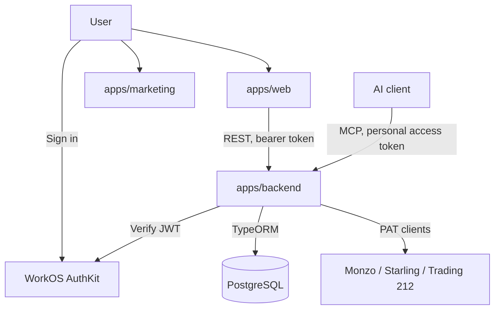

# Flump App Functionality Overview

Flump is a personal finance and tax planning app for UK users: you enter your own numbers and it shows net worth, take-home pay, debt, pension, mortgage and savings outcomes. This document is a short overview of the modules, how the code is organised and how the pieces connect.

> **Source of truth for routes and features:** the **[Pages & Features Catalog](pages_and_features.md)**. This overview is deliberately thin and will be regenerated after the E16 product review cuts land (see `docs/audit/EPICS.md`), so do not rely on it for feature-level detail. Unknown values are shown as "Not set", never as a default or invented figure.

---

## 1. Core Modules

### 1.1 Net Worth Dashboard

- **Aggregate balances**: latest balances across accounts give assets, liabilities and net worth. Student loan is shown as a separate income-contingent line, not in the headline debt.
- **Trend**: historical net worth over 6 months, 12 months or all time.
- **Allocation**: breakdown of capital by account type.

### 1.2 Accounts

- **Manual accounts**: Current, Savings, Credit Card, Investment, Loan, Mortgage (default currency GBP).
- **Bank connections (owner-only, beta)**: connect Monzo, Starling and Trading 212 using personal access tokens. This is not Open Banking OAuth; OAuth is disabled. Tokens are encrypted and never returned by the API. Bank connection is being put behind a flag, and synced transactions are being removed (decision recorded in `docs/audit/plans/DECISIONS.md`).
- **Account history**: balances over time, from check-ins.

### 1.3 Tax, Salary and Savings Tools

- **Take-home pay**: PAYE estimate from the UK tax-year rules (income tax bands, Personal Allowance, National Insurance, student loan, pension), by region (England/Wales/NI or Scotland). Needs a salary and region; otherwise it shows "Not set".
- **Savings and compound interest forecasts**, and a **Forecast** view that is planned to merge into the Savings, Pension and Tax pages.
- **Pension** modelling and **Debt** payoff planning (strategy comparison), each with its own page.
- **Tax-year rules** live in `packages/finance-engine`. Figures for each year are unverified until the owner signs off the test vectors; 2027/28 is not loaded yet and a fallback banner is planned.

### 1.4 Mortgage

- Remaining term, rate and balance tracking, an overpayment simulator, and an overpay-versus-save comparison.

### 1.5 Self-Employed and Rental Tax Ledger

- Cash-basis income and expenses for self-employment or rental property, with receipt upload (PDF or image). Receipts are stored in Postgres; validated serving through a download route is planned (E20).
- Profit and loss by tax year (6 April to 5 April) and a Self Assessment estimator: tapered Personal Allowance, Class 4 NI, Section 24 (20% credit for rental finance costs) and ownership shares for joint owners. The ledger is planned to become an opt-in module (E16).

### 1.6 Budget and Onboarding

- A plan-only monthly and annual budget (no live actuals yet).
- A short onboarding wizard for the baseline (salary, region, accounts); every numeric field starts empty.

### 1.7 Sandbox, Marketing and Agent Access

- **Sandbox**: a read-only demo for signed-out visitors with three personas.
- **Marketing site** (`apps/marketing`): home, tools directory with client-side calculators, pricing, security and guides.
- **MCP (preview)**: an authenticated MCP endpoint at `/mcp` on the backend and a `packages/mcp` server, with personal access tokens, read-anonymised and simulate scopes, and a context-pack export. Treat it as a preview; tax tools are marked unverified.

---

## 2. Technical Architecture

### 2.1 Monorepo Layout

- `apps/web`: React Router 7 app styled with Panda CSS; signed-in app.
- `apps/backend`: NestJS REST API with TypeORM on PostgreSQL; WorkOS JWT verification; `/health` and `/health/ready`.
- `apps/marketing`: public marketing and tools site.
- `apps/mobile-companion`: early React Native companion app (not released).
- `packages/ui`: design system (components and semantic tokens).
- `packages/finance-engine`: UK tax and finance calculations with test vectors.
- `packages/banking`: bank provider clients (Monzo, Starling, Trading 212).
- `packages/mcp`: MCP server, auth, tools, resources and prompts.
- `packages/common`: shared types and utilities.

### 2.2 Data Model

- **Account / AccountDetail**: accounts and balance snapshots.
- **Transaction**: synced transactions (being removed, see 1.2).
- **BankConnection**: encrypted provider tokens.
- **BudgetEntry**: planned budget lines.
- **TaxRecord**: self-employed and rental ledger entries.
- **UserProfile**: salary, region, employment type, ownership share and checklist state.
- **MCP tokens**: scoped personal access tokens for agents.

---

## 3. Integration Points

Hosting is Railway (three services from `main`, deployed through the release PR). Operations notes are in `docs/runbooks/`.
