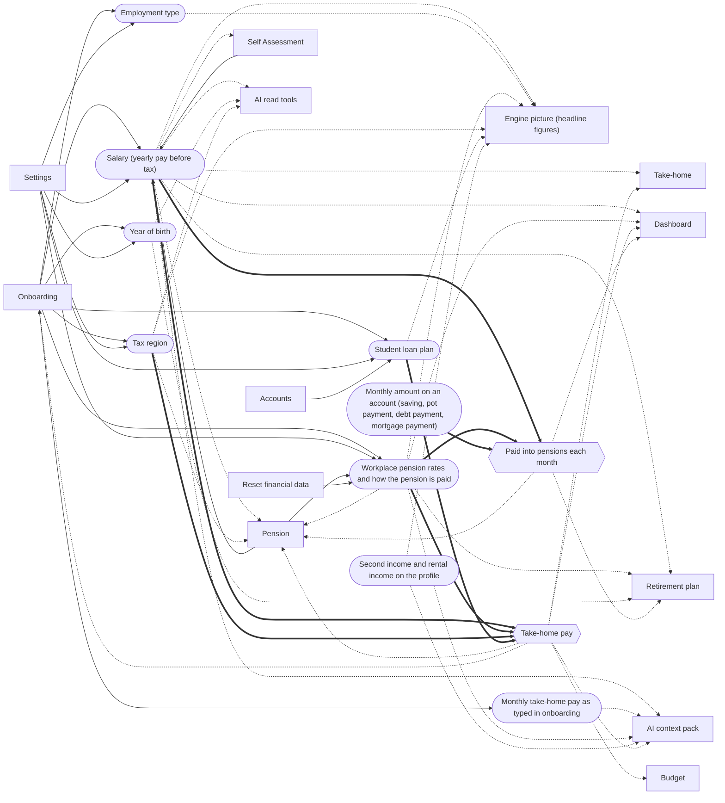
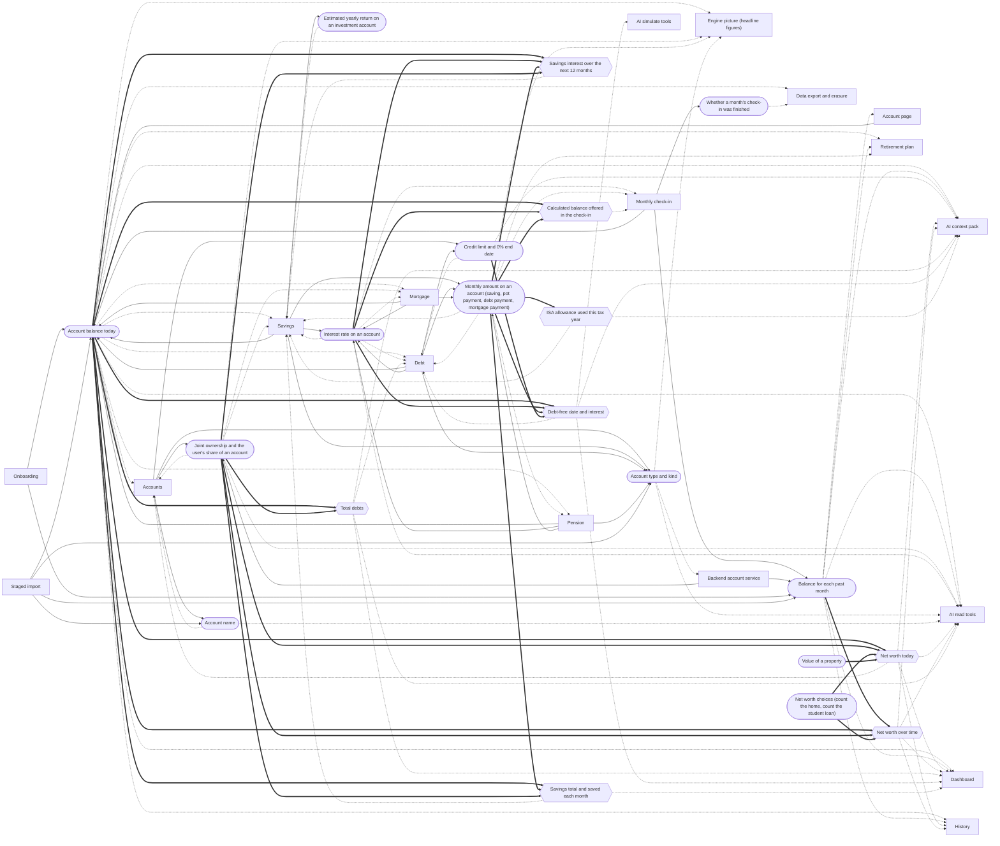
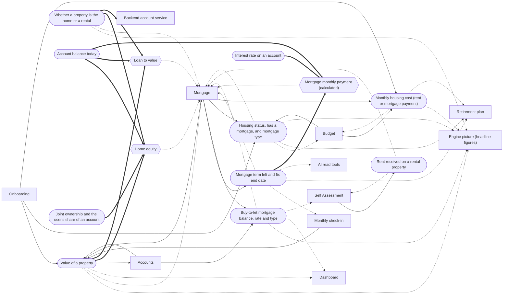
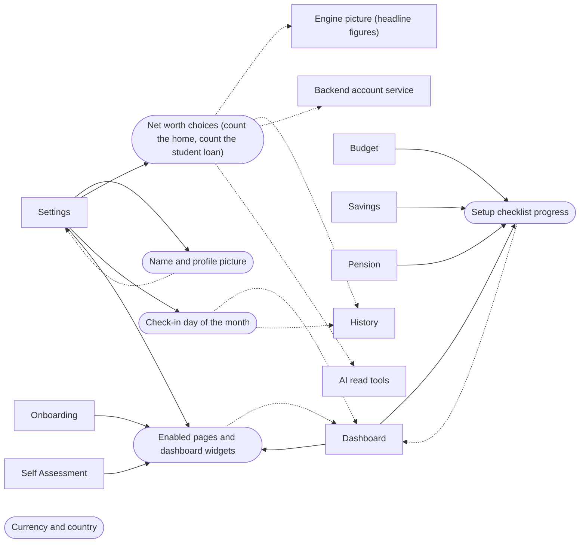
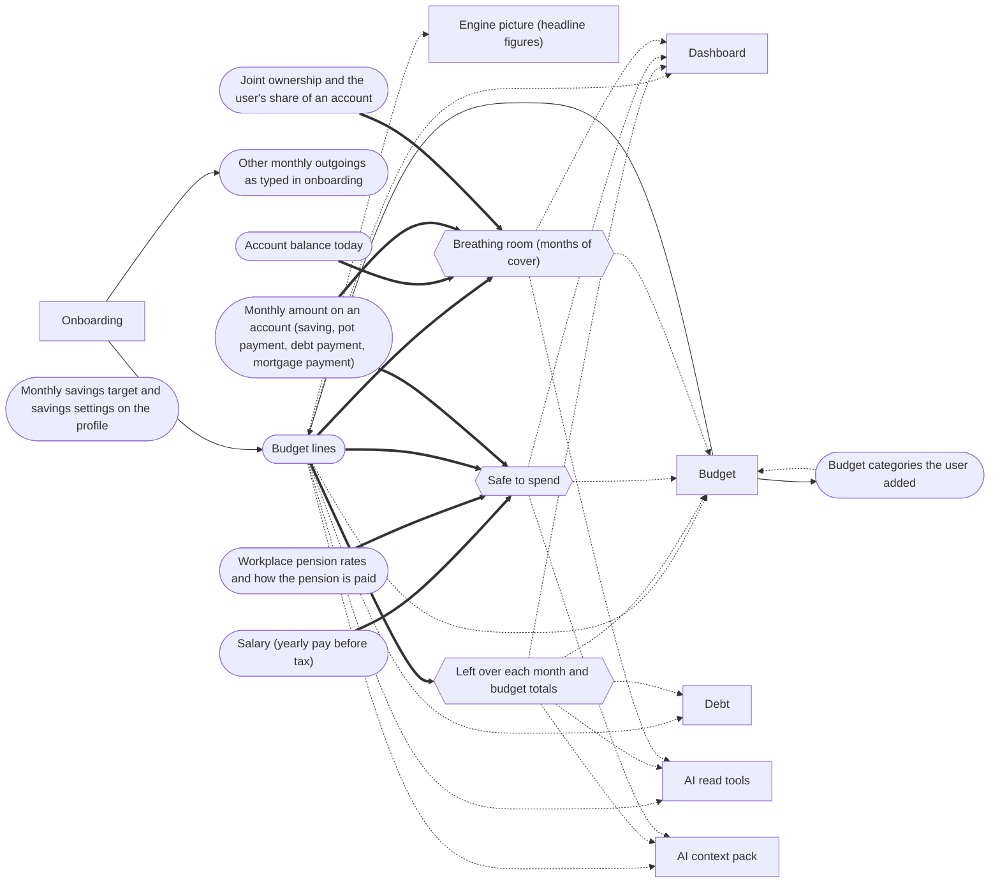
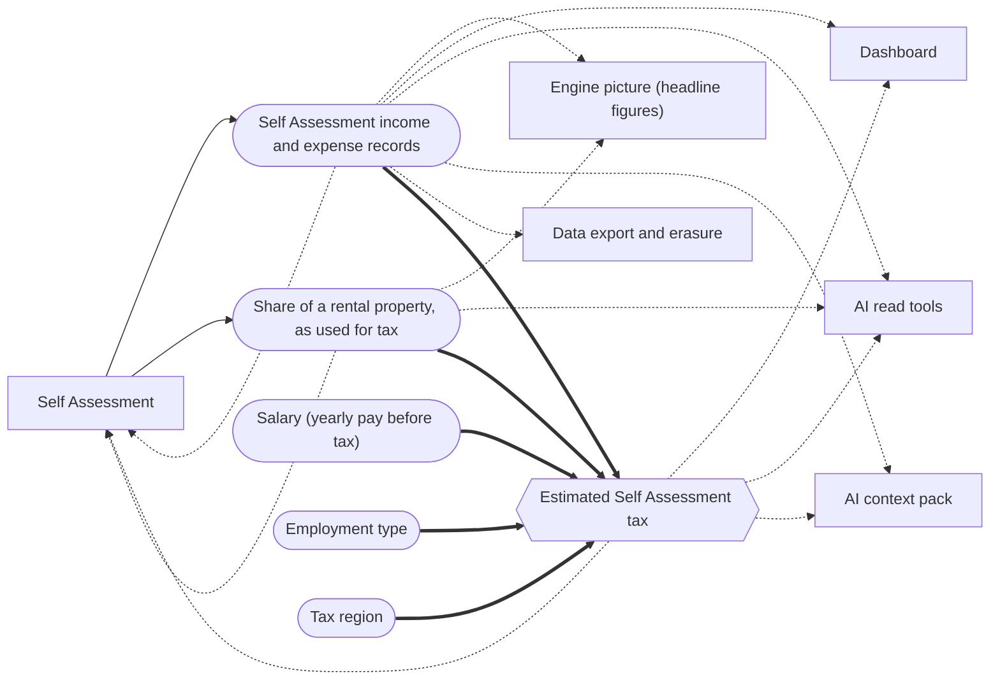
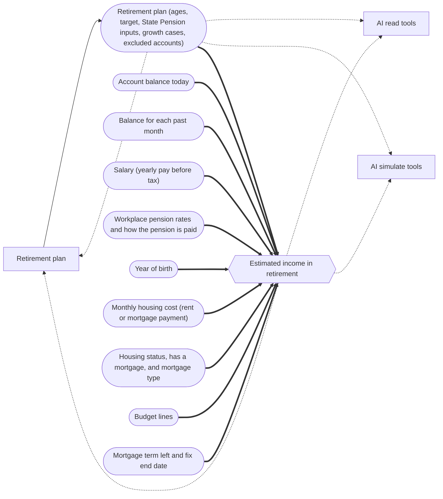

<!-- Generated by scripts/generate-value-map.ts from docs/system/value-map.yaml. Do not edit by hand. -->

# Value map: connections

One diagram per area. A solid arrow means the page or tool writes the value. A dotted arrow means it reads the value or shows the figure. A thick arrow means a figure is built from a fact.

## pay

## accounts

## home

## preferences

## budget

## tax

## retirement

